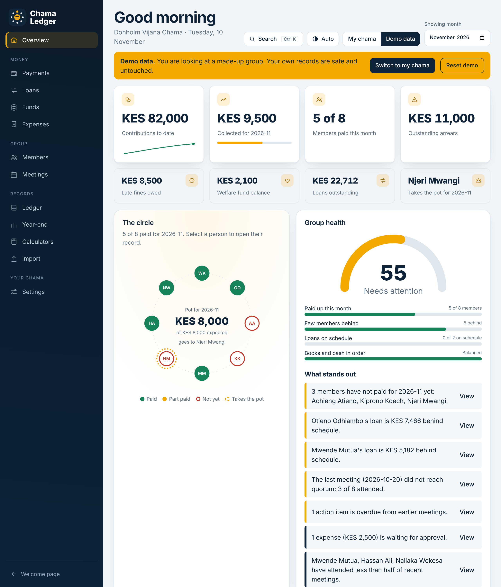
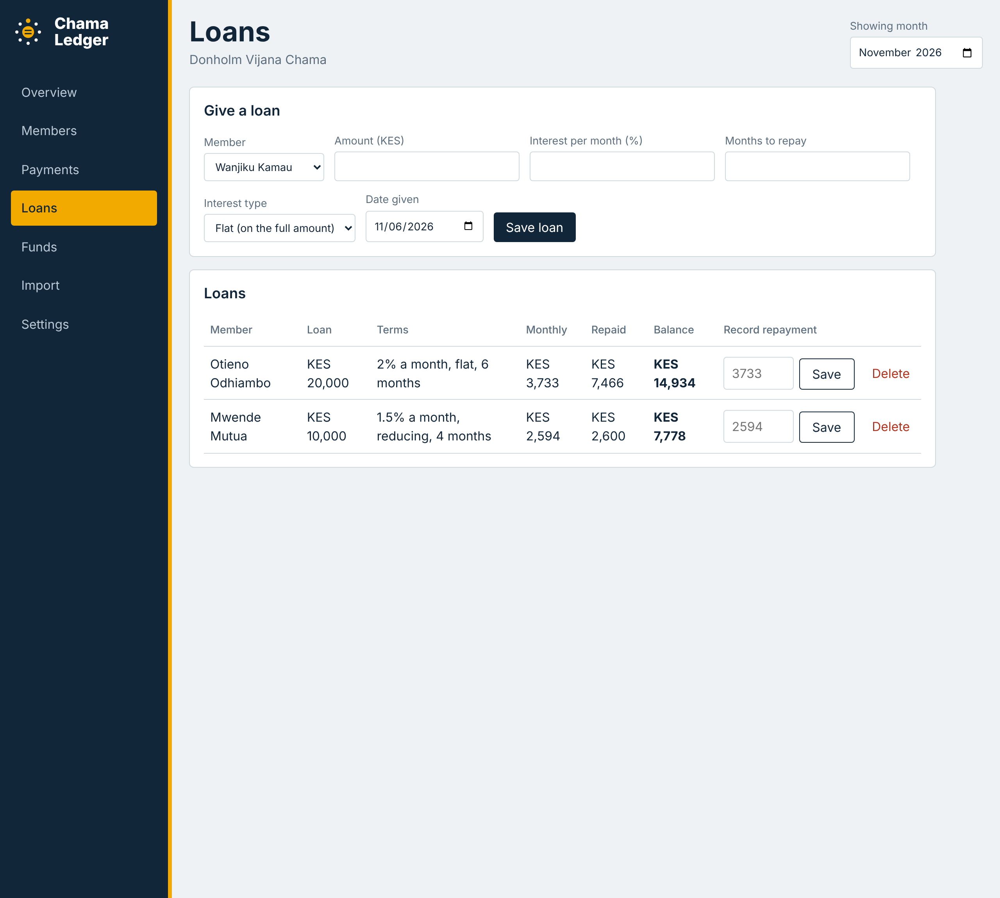
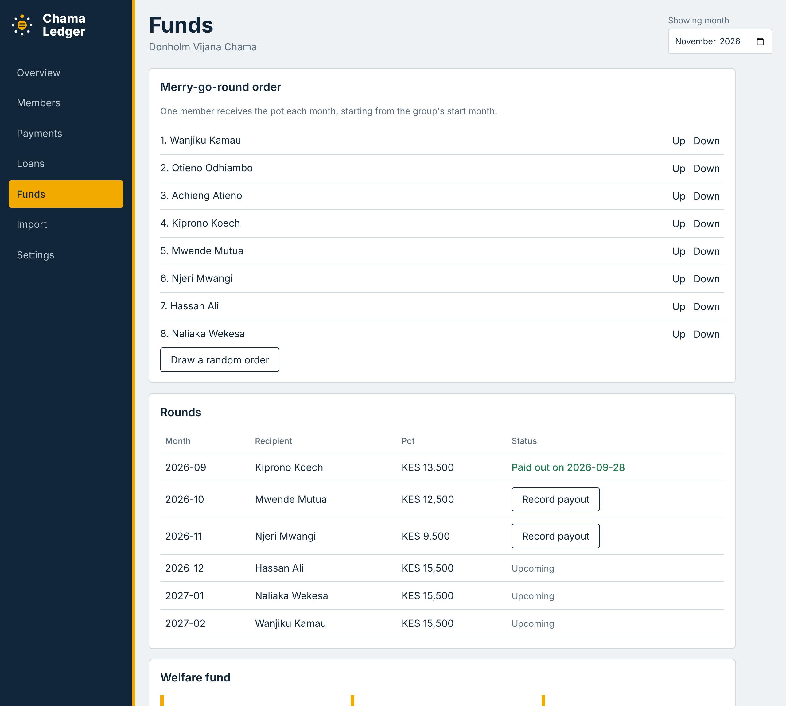
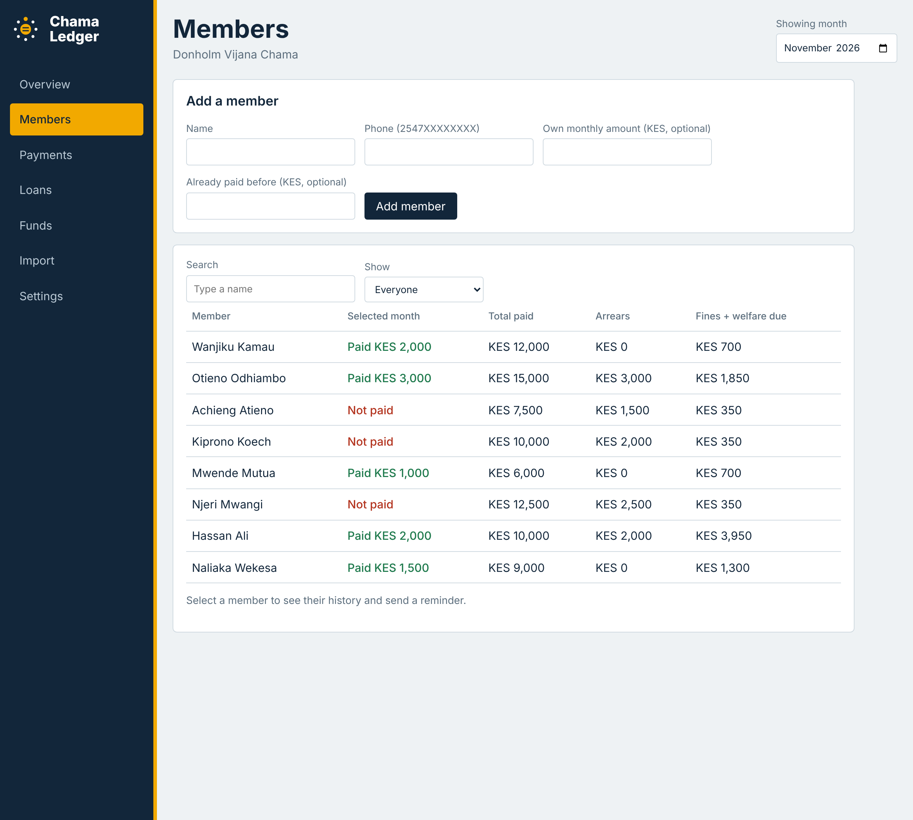
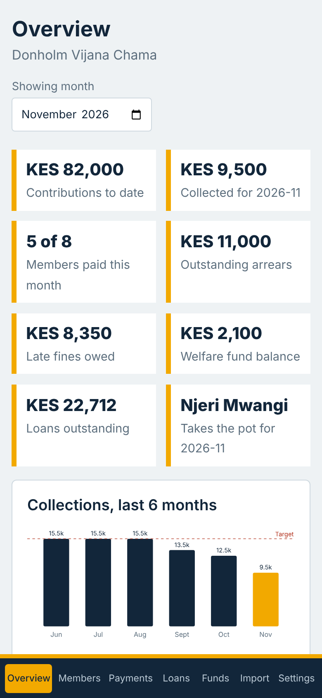

<p align="center">
  
</p>

<h1 align="center">Chama Ledger</h1>

<p align="center">
  One shared, trustworthy record for Kenyan chamas: contributions, fines, loans, welfare and the merry-go-round.
</p>

<p align="center">
  <a href="https://otienoryan786-lab.github.io/chama-ledger/">Live demo</a> · <a href="https://otienoryan786-lab.github.io/chama-ledger/app.html?mode=demo">Try the app with demo data</a>
</p>



## Screenshots

| Loans | Merry-go-round and welfare |
|---|---|
|  |  |

| Members | On a phone |
|---|---|
|  |  |

The screenshots show the built-in demo data (a made-up group), not real members.

## The problem

Chamas (savings groups) move a lot of money every month, but most keep their records in three places: **ledger books, WhatsApp chats and Word documents**. That causes the same problems again and again:

- Members dispute whether they paid, and nobody can prove it.
- M-Pesa codes get lost in message threads.
- The treasurer calculates fines, loan interest and the merry-go-round by hand.
- When a treasurer leaves, the history leaves with them.

Chama Ledger replaces the notebook with one record that anyone in the group can check.

## Features

**Contributions**
- Fixed contributions, or an **own monthly amount for each member** for groups where people pay what they can afford.
- Arrears worked out per member from the group's start month.
- Payments by **M-Pesa or cash**. A **duplicate M-Pesa code is rejected**, which prevents most disputes.
- **Balance brought forward** for members who paid before the group started using the app.

**Fines, welfare and loans**
- **Late fines** with rules set per chama: due day, grace days, and a flat amount, an amount per day late, or a percent of the contribution.
- **Welfare fund** with monthly collection, a balance and payouts with reasons.
- **Loans with interest**, either flat or reducing balance, with instalments, repayments and the balance still owed.

**Group policy**
- Each chama sets its own rules in **Settings** and on the **Year-end** page: merry-go-round as its own pot or paid from the contributions, how expenses are approved, and how the year-end share-out works. The app follows the policy instead of forcing one way.
- **Templates:** start from a ready-made policy (small friends' chama, savings and investment group, formal group with votes) and adjust it.
- **Expenses with approvals:** the treasurer records them directly, officials sign off (multi-signature), or members vote. Smaller amounts can skip approval. The person who recorded an expense cannot approve it, each expense shows who approved or declined it, and a WhatsApp message asks an approver to review. Approved expenses are taken off the year-end income automatically.
- **A balanced ledger:** every payment, fine, loan, payout and expense is worked out as a balanced entry between named funds (savings, fines, welfare, the merry-go-round pot, loans owed, loan interest, expenses and cash). The **Funds** page shows each fund, checks that the books balance, and estimates the cash that should be in the account. Nothing is stored twice, so the ledger cannot drift out of step with the records.

**Year-end and calculators**
- **Year-end share-out** from your own records. Choose how your chama shares: by savings, by savings and time, or equally. It can add loan interest and fines, add other income, take off expenses and unpaid loans, and return savings or only the share. Print it, copy it or download it as CSV.
- **Calculators** for any chama, with no setup: loan schedules (flat or reducing balance), late fines, merry-go-round plans, a quick year-end, savings goals and loan limits.

**Merry-go-round**
- Rotation order you can reorder or draw at random, a list of past and coming rounds with the pot, and a record of each payout.

**Dashboard**
- Overview cards, a six-month collections chart with a target line, a progress ring, biggest arrears and latest payments.
- Member search and filters (paid, not paid, in arrears), plus a member profile with history.
- **WhatsApp reminder** button that opens a ready-written message for a member who owes money.

**Bringing in existing records**
- **Paste WhatsApp or M-Pesa messages.** The app finds the M-Pesa code, amount, date and sender, with a preview before saving.
- **Paste a table from Word or Excel**, with months across the top and member names down the side.
- Every import shows a preview where you can fix details, and duplicates are flagged and skipped.

**Data**
- CSV export of all payments.
- A **My chama / Demo data switch** in the top bar. Explore a made-up group any time, then switch back. The demo is stored separately, so your real records are never touched.

## How to run

No install and no build step. You only need a browser.

1. Download or clone the repository.
2. Open `index.html`, the welcome page, and click **Open the app**. You can also open `app.html` directly.
3. Click **Explore with demo data** to look around, or use **Open the app** and go to **Settings** to enter your group's details. Inside the app, the **My chama / Demo data** switch and the **Welcome page** link are in the top bar.

```bash
git clone https://github.com/otienoryan786-lab/chama-ledger.git
cd chama-ledger
# then open index.html in your browser
```

## Tests

The rules in `engine.js` (policy, ledger, share-out, expense approvals) have automated tests. They need only Node.js:

```bash
node tests/engine.test.js
# or: npm test
```

The same tests run automatically on GitHub whenever code is pushed.

## How data is stored

Everything is saved in your browser's `localStorage`. There is no server, and nothing leaves your device. This is fine for trying the app out, but it means:

- Data lives on one device and one browser only.
- Clearing browser data erases it, so use **Download payments (CSV)** to keep a copy.
- Please don't commit real member names, phone numbers or exported CSV files to this repository.

A shared database with logins is the next phase (see the roadmap).

## Importing your records

**WhatsApp or M-Pesa messages.** Paste one message per line. Each line needs a 10-character M-Pesa code, for example `SJK4X9ABCD`:

```
SJK4X9ABCD Confirmed. Ksh2,000.00 received from WANJIKU KAMAU 0712000001 on 5/11/26
```

**Tables from Word or Excel.** The first row has the months (`Jan`, `Feb` or `2026-01`), the first column has names, and the cells hold the amount paid:

```
Name              Jan    Feb    Mar
Wanjiku Kamau     2000   2000
Otieno Odhiambo   2000          2000
```

Records imported from a table have no payment date, so they are treated as paid on the due date and don't produce late fines.

## Project structure

```
chama-ledger/
├── index.html   Welcome page: what Chama Ledger is, who it is for, project status
├── welcome.css  Styling for the welcome page
├── app.html     The app: dashboard, members, payments, loans, funds, expenses, year-end, calculators, import, settings
├── style.css    Styling for the app, including the mobile layout
├── app.js       Logic: data, money rules, rendering, import, demo data
├── engine.js    The rules: policy, balanced ledger, share-out and expense approvals (no page code, tested in Node)
├── governance.js   Screens and helpers on top of the engine: roles, merry-go-round pot, Expenses, fund balances
├── calculators.js  Calculators and the year-end share-out
├── _headers     Security headers for hosts that support them
├── LICENSE      Terms of use
├── SECURITY.md  What must never be committed, and how to report problems
├── tests/
│   └── engine.test.js  Node tests for policy, ledger, share-out and approval rules
├── package.json  Lets `npm test` run the tests
├── .github/workflows/test.yml  Runs the tests on every push
├── logo.svg     Logo and favicon
├── docs/        Screenshots used in this README
└── README.md
```

Plain HTML, CSS and JavaScript, with no frameworks or libraries. The charts are drawn as SVG by `app.js`.

## Security and ownership

- The repository contains **no secrets and no real member data**. A chama's records stay in the user's own browser. See [SECURITY.md](SECURITY.md).
- Pages carry a Content-Security-Policy that blocks scripts and requests from anywhere but this site. `_headers` adds more protections on hosts that support it.
- The code is published to be read, not reused. See [LICENSE](LICENSE): all rights reserved, with no copying, hosting or commercial use without permission.
- Expense approvals are local records against member roles, not verified signatures. The app has no sign-in or identity verification yet, so approvals rely on honesty until logins arrive.
- Front-end code can always be read by anyone who opens the app, so anything that must be trusted (logins, who sees which chama, M-Pesa) will live on a server in the next phase, with secrets kept in environment variables.

## Roadmap

- [x] Dashboard, members, payments and CSV export
- [x] Import from WhatsApp messages and Word or Excel tables
- [x] Own monthly amounts, late fines, welfare fund, loans and merry-go-round
- [x] Welcome page that explains the project and links into the app
- [x] Switch between your own records and demo data
- [x] Group policy with templates: merry-go-round modes, expense approvals and remembered year-end choices
- [x] Balanced ledger with fund balances and an estimated cash position
- [x] Automated tests for the rules, run on every push
- [ ] Fine cap setting
- [ ] Loan limits and guarantors
- [x] Year-end share-out of savings and interest
- [x] Calculators for loans, fines, rotations, year-end, savings goals and loan limits
- [ ] Backend and database, so a whole group shares one record
- [ ] Member logins and roles (treasurer, official, member)
- [ ] M-Pesa STK push for contributions
- [ ] Automatic SMS and WhatsApp reminders
- [ ] Printable monthly statements

## Built from field research

The features come from conversations with real chamas. So far:

- Records are kept in ledger books, WhatsApp chats and Word documents.
- Some chamas fix the contribution and others set it by what each member can afford.
- Late fines exist and differ from one chama to the next.
- Most chamas run a merry-go-round, some have a welfare fund, and most give loans with interest.

More research is under way, and the rules in the app will keep following what chamas actually do.

## Author

**Ryan Otieno**, graphic designer and software development student, Nairobi, Kenya. Chama Ledger is a portfolio project built to solve a real problem for community savings groups.

## Contributing and feedback

Treasurers and chama members: if the rules in your group are not covered here, please open an issue and describe how your chama handles them.
